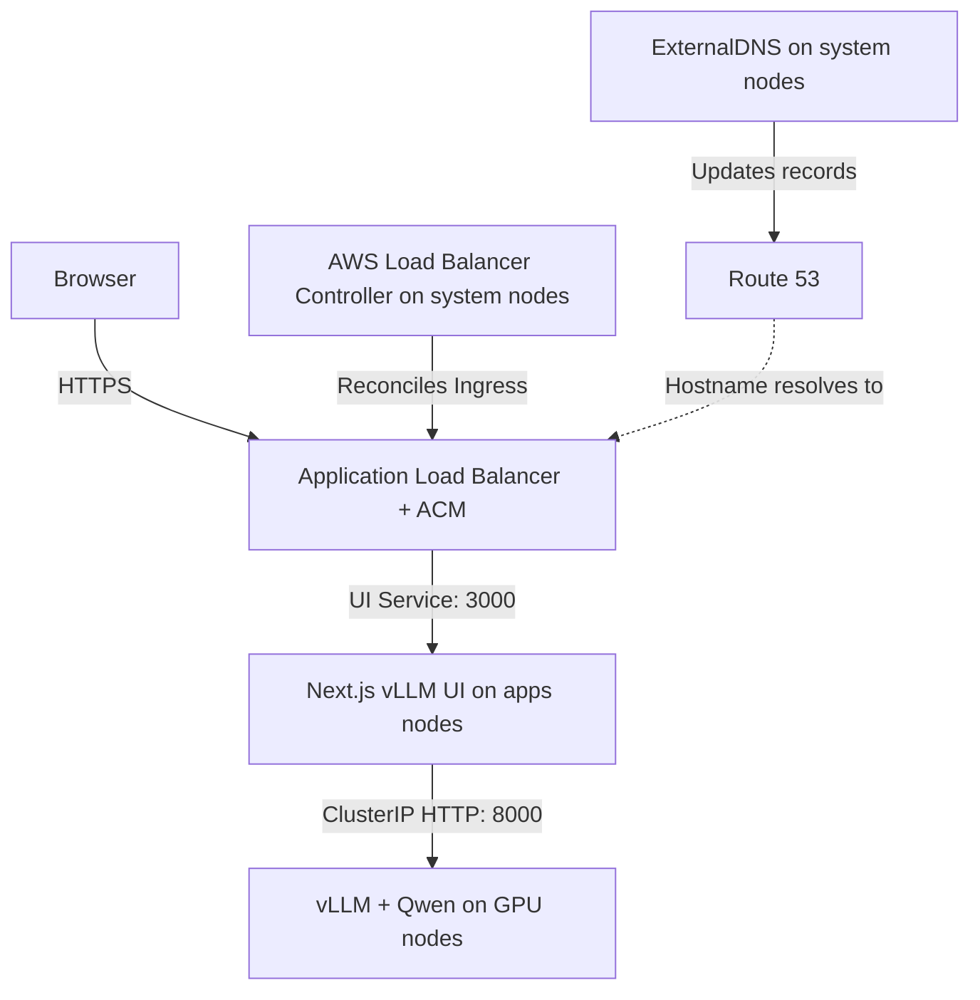

# 🚀 AWS EKS GPU Infrastructure — Terraform Modules

A hands-on AWS platform lab built with **Terraform modules**, **Amazon EKS**, and **GitHub Actions**. The project now includes dedicated system, application, and GPU node groups; NVIDIA GPU support; and Kubernetes manifests for **vLLM inference with a Next.js chat UI exposed over HTTPS**.

> **Status:** Working infrastructure and model-serving lab, evolving toward a reusable EKS template. **vLLM and Next.js vLLM UI have both been implemented and successfully tested end to end on EKS.** Production hardening is still in progress. Terraform manages the infrastructure, add-ons, and Helm releases; application workloads are applied separately with `kubectl`. The GPU node group starts with **zero nodes**.

**Documentation snapshot:** `master` at [`d62d6a9`](https://github.com/tomteresz/buildk8scluster/commit/d62d6a9a83066fb2acc5694cf72885c5e09a8edb), 16 October 2026.

## ✨ Recent Changes

- Split worker capacity into **`system`, `apps`, and `gpu` managed node groups**, each with its own EC2 launch template, labels, taints, and instance/volume tags.
- Added explicit placement for infrastructure controllers on system nodes and NVIDIA components on GPU nodes.
- Added the NVIDIA Device Plugin, a GPU smoke test, and vLLM/UI workload manifests with ALB, ACM, and ExternalDNS integration.
- Added vLLM startup, readiness, and liveness probes, plus a `Recreate` deployment strategy for the single-GPU lab.
- Pinned Metrics Server to **`v0.9.0-eksbuild.11`** to address the lab's Load Balancer Controller Helm installation problem. The temporary `disable_openapi_validation` override is now commented out.

## 🏗️ Architecture

| Layer | Current implementation |
| --- | --- |
| Region and networking | `eu-central-1`; VPC `192.168.0.0/16`; 12 `/24` subnets across 3 AZs: 6 public and 6 private |
| Routing | Internet Gateway, regional NAT Gateway, subnet route tables, and ALB subnet-discovery tags |
| Kubernetes | Amazon EKS **1.35**, with public and private API endpoints |
| Compute | Three managed SPOT node groups: system, apps, and GPU; workers use private subnets `192.168.23.0/24`–`192.168.25.0/24` |
| Identity | GitHub OIDC for workflow access to AWS; EKS OIDC/IRSA for VPC CNI, ExternalDNS, EBS CSI, and Load Balancer Controller |
| Encryption and logs | KMS encryption for Kubernetes secrets, key rotation, encrypted `gp3` node root volumes, and all five EKS control-plane log types with 30-day CloudWatch retention |
| Ingress and DNS | AWS Load Balancer Controller provisions ALBs; ACM terminates HTTPS; ExternalDNS manages Route 53 records with `sync` policy |
| Terraform state | Encrypted, versioned S3 backend with DynamoDB locking; backend resources are bootstrapped separately |

The application path below uses the apps-node placement described in the deployment section.



The vLLM API is an internal `ClusterIP` Service. The UI talks to it through Kubernetes DNS; the public Ingress targets the UI.

## 🖥️ Node Groups and Scheduling

| Group | Node label | Taint with `NoSchedule` effect | EC2 instance candidates | Desired / min / max | Root volume |
| --- | --- | --- | --- | --- | --- |
| System | `workload-type=system` | `workload-type=system` | `t3.medium`, `t3a.medium` | `1 / 1 / 2` | 20 GiB encrypted `gp3` |
| Apps | `workload-type=apps` | `workload-type=apps` | `t3.medium`, `t3a.medium` | `1 / 1 / 2` | 20 GiB encrypted `gp3` |
| GPU | `workload-type=gpu` | `nvidia.com/gpu=true` | `g5.xlarge`, `g6.xlarge`, `g4dn.xlarge` | `0 / 0 / 1` | 50 GiB encrypted `gp3` |

System and apps nodes use `AL2023_x86_64_STANDARD`; GPU nodes use `AL2023_x86_64_NVIDIA`. Each group references its own launch template's latest version.

All three groups are tainted. A `nodeSelector` chooses a group, while a matching `toleration` allows a Pod to use it.

**Scaling bounds do not install an autoscaler.** No Karpenter or Cluster Autoscaler is configured. To run the GPU workload, change the GPU group's `desired_size` in `ng.tf` from `0` to `1` and apply Terraform. Pending GPU Pods alone will not create a node.

### Infrastructure Components

| Component | Installation | Scheduling configured in this repository |
| --- | --- | --- |
| VPC CNI | EKS add-on | Add-on defaults; no custom scheduling override |
| kube-proxy | EKS add-on | Add-on defaults; no custom scheduling override |
| CoreDNS | EKS add-on | System selector and matching toleration; also retains explicit control-plane and `CriticalAddonsOnly` tolerations |
| Metrics Server | EKS add-on, `v0.9.0-eksbuild.11` | System selector and tolerations |
| EKS Node Monitoring Agent | EKS add-on | `dcgmAgent` specifically targets GPU nodes and tolerates the GPU taint; other components keep add-on defaults |
| ExternalDNS | EKS add-on | System selector and tolerations; IRSA trust targets `external-dns:external-dns` |
| EBS CSI controller | EKS add-on | System selector and tolerations; IRSA uses `AmazonEBSCSIDriverPolicyV2` |
| EBS CSI node component | Same EKS add-on | Add-on defaults; the custom placement applies to the controller |
| AWS Load Balancer Controller | Helm | System selector and toleration; Terraform-created ServiceAccount with IRSA |
| NVIDIA Device Plugin | Helm chart **`0.19.3`** | GPU selector and GPU-taint toleration |

Most EKS add-on versions and the Load Balancer Controller chart remain unpinned. The Metrics Server add-on and NVIDIA Device Plugin chart are explicitly pinned.

## 📁 Repository Layout

Paths below are relative to `eks-gpu-modules/`.

| Path | Purpose |
| --- | --- |
| `modules/vpc/` | VPC, DHCP options, Internet Gateway, and regional NAT Gateway |
| `modules/subnets/` | Reusable single-subnet module |
| `modules/routes/` | Route table and subnet association module |
| `modules/sgs/` | Empty placeholder |
| `vpc.tf`, `routes.tf` | Subnet and route module instances |
| `eks.tf` | EKS cluster, launch templates, KMS, IAM/IRSA, and access entries |
| `ng.tf` | System, apps, and GPU managed node groups |
| `addons.tf` | EKS managed add-ons and their scheduling configuration |
| `helm.tf` | Load Balancer Controller and NVIDIA Device Plugin |
| `terraform.tf`, `variables.tf`, `locals.tf` | Backend, providers, input defaults, and derived values |
| `outputs.tf` | Network, CloudWatch log-group, and client-IP outputs |
| `policies/` | IAM policies for Load Balancer Controller and ExternalDNS |
| `workloads/vllm/` | Namespace, vLLM Deployment, and internal Service |
| `workloads/next-js-vllm-ui/` | Namespace, UI Deployment, Service, and HTTPS Ingress |
| `workloads/gpu-test/nvidia-smi.yaml` | One-GPU smoke-test Pod in namespace `test` |
| `workloads/nginx/` | Optional nginx application, Service, and HTTPS Ingress |
| `workloads/ingress.yaml` | Controller test pointing to `non-existent-service`; not a functional application |
| `delete.bat` | Emergency manual cleanup utility |

GitHub Actions workflows live in the repository root under `.github/workflows/`.

## ✅ Prerequisites and Configuration

- AWS permissions for the infrastructure, a GitHub Actions OIDC role, and EKS access for the identity running `kubectl`.
- Terraform satisfying `~> 1.16`, AWS CLI, and `kubectl`. Helm releases are managed by Terraform.
- An EC2 key pair matching `ec2_ssh_key`; the current default is `ff-ec2-key`.
- An S3 state bucket and DynamoDB lock table created before `terraform init`.
- For HTTPS/DNS: an existing Route 53 hosted zone and an ACM certificate in the ALB's region covering the chosen hostname.
- For GPU inference: sufficient EC2 GPU SPOT quota/capacity and outbound access to the image registries and model source.

Review the lab-specific settings before deploying into another account:

| Location | Values to review |
| --- | --- |
| `variables.tf` | Region, project name, Kubernetes version, key pair, and Windows-specific AWS config/credential paths |
| `terraform.tf` | Backend bucket `eks-gpu-state`, key `state/terraform.tfstate`, region, and lock table `eks-gpu-dev-lock` |
| `eks.tf` | Administrative IAM principal and EKS public API CIDR |
| `policies/ext_dns_iam_policy.json` | Route 53 hosted-zone ARN |
| UI/nginx Ingress manifests | ACM certificate ARN, hostnames, and ALB names |
| `vpc.tf` | Hard-coded subnet CIDRs and AZs; changing `aws_region` alone does not move the whole configuration |
| `.github/workflows/` | AWS role ARN, region, and bootstrap backend names |

The actual EKS cluster name comes from `project_name`, which defaults to **`eks-gpu`**. The separate `eks_cluster` variable is used in several IAM, KMS, and log names.

For local deployment, override `shared_config_files` and `shared_credentials_files` to valid paths for your workstation. Keep AWS CLI authentication and region consistent with the Terraform AWS provider: the Kubernetes and Helm providers obtain EKS tokens by executing `aws eks get-token`.

## 🚀 Deploy the Infrastructure

### 1. Bootstrap the backend

Run **`terraform-bootstrap.yml`** (`Bootstrap_backend`), or create equivalent backend resources separately. The workflow enables S3 versioning and encryption, blocks public bucket access, and creates a DynamoDB table with the `LockID` key.

### 2. Review and apply Terraform

Enable one GPU node in `ng.tf` first if you intend to deploy vLLM during this run.

```bash
cd eks-gpu-modules
terraform init
terraform fmt -check -recursive
terraform validate
terraform plan
terraform apply
```

Alternatively, run **`terraform-plan.yml`** and then **`terraform-apply.yml`**, entering `apply` in its confirmation input. The apply workflow creates and applies its own saved plan; it does not consume the standalone plan workflow's output.

The workflows use GitHub OIDC for AWS authentication and run Terraform from `eks-gpu-modules`. They do not apply the application manifests.

### 3. Connect to EKS

```bash
aws eks update-kubeconfig --region eu-central-1 --name eks-gpu
kubectl get nodes -L workload-type
kubectl get pods -A -o wide
```

Substitute your region and cluster name if you changed the defaults.

## 🤖 Deploy vLLM and the UI

### 1. Prepare application scheduling and ingress

The committed vLLM Deployment already selects GPU nodes and tolerates `nvidia.com/gpu`.

**The UI and nginx Deployment manifests still lack apps-node scheduling.** With the current taints, they can remain `Pending`. Add the following fields under `spec.template.spec`, alongside `containers`, in `workloads/next-js-vllm-ui/10-deployment.yaml` and, if used, `workloads/nginx/deployment.yaml`:

```yaml
nodeSelector:
  workload-type: apps
tolerations:
  - key: workload-type
    operator: Equal
    value: apps
    effect: NoSchedule
```

In the UI's `30-ingress.yaml`, update the ACM ARN and all hostname fields for your environment. The committed example uses `vllm-ui.tom-tech.info`, ALB name `vllm-ui`, HTTP/HTTPS listeners, and a redirect from HTTP to HTTPS.

Also reconcile the UI's `VLLM_TOKEN_LIMIT=8192` with the server's `--max-model-len=4096`. Prompt and generated tokens must fit within the server's context window.

### 2. Verify the GPU

Confirm the GPU node is ready and exposes `nvidia.com/gpu`:

```bash
kubectl get nodes -l workload-type=gpu
kubectl describe nodes -l workload-type=gpu
kubectl create namespace test --dry-run=client -o yaml | kubectl apply -f -
kubectl apply -f workloads/gpu-test/nvidia-smi.yaml
kubectl get pod -n test nvidia-smi-test
```

After the test Pod reaches `Completed`, inspect its output and remove it before starting inference:

```bash
kubectl logs -n test nvidia-smi-test
kubectl delete -f workloads/gpu-test/nvidia-smi.yaml
```

The test requests one GPU. Do not run it alongside vLLM on this single-GPU setup.

### 3. Apply the serving workloads

```bash
kubectl apply -f workloads/vllm/
kubectl rollout status deployment/vllm-deploy -n vllm --timeout=15m

kubectl apply -f workloads/next-js-vllm-ui/
kubectl rollout status deployment/vllm-ui-deploy -n vllm-ui --timeout=5m
kubectl get ingress -n vllm-ui
```

Apply these directories individually. A recursive apply of all `workloads/` would also deploy optional tests and examples.

### Current Model-Serving Configuration

| Setting | Value in the manifests |
| --- | --- |
| Model | `Qwen/Qwen2.5-0.5B-Instruct` |
| vLLM image | `vllm/vllm-openai:latest` |
| UI image | `ghcr.io/yoziru/nextjs-vllm-ui:latest` |
| Inference configuration | `float16`; maximum model length `4096`; GPU-memory utilization `0.85` |
| vLLM resources | Requests: 1 CPU, 2 GiB RAM; limits: 2 CPUs, 8 GiB RAM, 1 GPU |
| Deployment strategy | One replica with `Recreate`, allowing the old Pod to release the GPU before replacement |
| Internal API | `http://vllm-svc.vllm.svc.cluster.local:8000` |
| Health endpoint | `/health` for startup, readiness, and liveness probes |
| Model storage | Downloaded by vLLM at startup; no persistent model-cache volume is defined |

The startup probe allows approximately 10 minutes before its failure threshold is reached. Readiness checks run every 10 seconds and liveness checks every 30 seconds. First startup depends on image/model download time; adjust the startup budget when testing larger models.

`Recreate` introduces downtime during upgrades. It fits the current one-GPU lab and is not a high-availability rollout strategy.

## 🧪 Validation and Troubleshooting

### Successfully Tested vLLM and Next.js vLLM UI

Manual end-to-end testing confirmed the working integration of the vLLM inference backend and the Next.js vLLM UI:

- A prompt submitted through the chat UI returned a generated response from the model served by vLLM.
- The UI was accessible at `https://vllm-ui.tom-tech.info` over HTTPS, with the browser confirming a secure connection.

For a fresh deployment from the committed manifests, apply the apps-node scheduling additions documented above.

### Cluster, placement, and metrics

```bash
aws eks describe-cluster --name eks-gpu --region eu-central-1 --query 'cluster.status'
aws eks list-addons --cluster-name eks-gpu --region eu-central-1
kubectl get nodes -L workload-type
kubectl get pods -A -o wide
kubectl get deployment aws-load-balancer-controller -n kube-system
kubectl get daemonsets -n kube-system
kubectl top nodes
kubectl get events -A --sort-by='.lastTimestamp'
```

### Latest Metrics Server / Helm fix

[Commit `361c8be`](https://github.com/tomteresz/buildk8scluster/commit/361c8be8f9a0f13d361d067a3a707b23f77836d6) pins the managed Metrics Server add-on to `v0.9.0-eksbuild.11` and comments out the temporary `disable_openapi_validation = true` line in the Load Balancer Controller Helm release.

When reproducing the Helm/OpenAPI issue, inspect Metrics Server and its API registration as well as the Helm release:

```bash
aws eks describe-addon --cluster-name eks-gpu --addon-name metrics-server --region eu-central-1 --query 'addon.{version:addonVersion,status:status,health:health}'
kubectl get apiservice v1beta1.metrics.k8s.io
kubectl describe apiservice v1beta1.metrics.k8s.io
kubectl logs -n kube-system deployment/metrics-server
kubectl get --raw /apis/metrics.k8s.io/v1beta1/nodes
```

The current repository fix uses the pinned add-on version; bypassing OpenAPI validation is not an active setting.

### Test the internal inference API

Run the port-forward in one terminal:

```bash
kubectl port-forward -n vllm service/vllm-svc 8000:8000
```

Then query it from another terminal:

```bash
curl --fail http://127.0.0.1:8000/health
curl --fail http://127.0.0.1:8000/v1/models
curl --fail http://127.0.0.1:8000/v1/chat/completions \
  -H 'Content-Type: application/json' \
  -d '{"model":"Qwen/Qwen2.5-0.5B-Instruct","messages":[{"role":"user","content":"Hello!"}],"max_tokens":64}'
```

For a `Pending` Pod, use `kubectl describe pod` in its namespace to inspect taint, selector, GPU, and resource scheduling errors. For startup failures, inspect `kubectl logs -n vllm deployment/vllm-deploy`.

The standalone `workloads/ingress.yaml` intentionally references a missing Service; use the UI or nginx manifests for a functional ALB application test.

## 🧹 Destroy

**Remove manually applied Ingresses while the Load Balancer Controller is still running.** Controller-created ALBs and their AWS dependencies must be cleaned up before Terraform removes the cluster and VPC.

### 1. Delete the example Ingresses you deployed

```bash
kubectl delete -f workloads/next-js-vllm-ui/30-ingress.yaml --ignore-not-found
kubectl delete -f workloads/nginx/ingress.yaml --ignore-not-found
kubectl delete -f workloads/ingress.yaml --ignore-not-found
kubectl get ingress -A
```

Wait for Ingress deletion to finish and verify that the associated AWS load balancers have been removed. Check for any additional Ingress or `LoadBalancer` Service resources created during testing.

### 2. Remove the remaining workloads

```bash
kubectl delete -f workloads/next-js-vllm-ui/ --ignore-not-found
kubectl delete -f workloads/vllm/ --ignore-not-found
kubectl delete -f workloads/nginx/ --ignore-not-found
kubectl delete -f workloads/gpu-test/nvidia-smi.yaml --ignore-not-found
```

### 3. Destroy the Terraform-managed infrastructure

```bash
terraform destroy
```

Alternatively, run **`terraform-destroy.yml`** and enter `destroy`. That workflow operates on Terraform state and does not perform the Kubernetes workload cleanup above.

The S3 backend and DynamoDB lock table are separate bootstrap resources and remain after infrastructure destruction. `delete.bat` is an emergency, best-effort manual cleanup script; review it before use.

## ⚠️ Current Lab Limitations

- The EKS public API CIDR is `0.0.0.0/0` for GitHub-hosted runner access; restrict it when designing a production setup.
- System and apps groups each start with one SPOT node. Capacity, resilience, and application availability are not guaranteed by the three-AZ subnet layout.
- GPU capacity starts at zero and requires an explicit scaling change; node and Pod autoscaling are not installed.
- UI/nginx apps placement still needs the manifest additions described above.
- Most add-on/chart versions are unpinned, and both serving images use `latest`.
- EBS CSI is available, but the vLLM manifests do not use a PVC or a persistent model cache.
- EC2 launch templates do not explicitly declare IMDSv2 `metadata_options`.
- Account-specific values and repeated subnet/route module calls remain.
- No application authentication layer, GitOps deployment, full observability stack, or disaster-recovery workflow is defined.

## 🗺️ Next Steps

1. Complete apps-node scheduling and align UI/server token settings.
2. Pin the remaining add-on/chart versions and serving images; validate upgrades with a repeatable smoke test.
3. Add persistent model storage/cache and define how model versions are promoted.
4. Introduce node and workload autoscaling with clear GPU cost limits.
5. Move application deployment into GitOps, for example Argo CD, while keeping infrastructure ownership clear.
6. Extend monitoring for GPU utilization, inference latency, errors, and token throughput.
7. Progressively tighten API access, IAM, EC2 metadata settings, application access controls, and availability.

---

**Purpose:** Validate the full lifecycle — **plan → apply → deploy workloads → test inference → clean up workloads → destroy** — and turn the working lab into a reusable EKS platform template.
